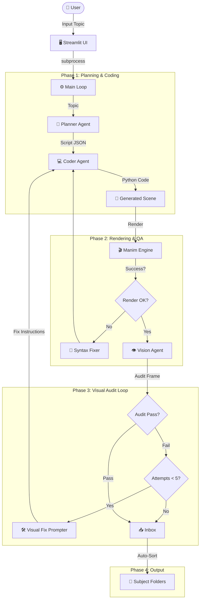

# LLManim Agent 🎬

[](https://www.python.org/)
[](https://www.manim.community/)
[](https://azure.microsoft.com/en-us/services/cognitive-services/speech-services/)

**LLManim Agent** 是一個先進的自動化教學影片生成系統。它結合了大型語言模型 (LLM)、確定性算法模板與語音合成技術，能夠自動產出高品質、影音同步且具備互動性的數學教學影片。

---

## ✨ 核心功能 (Key Features)

## 🏗️ 系統架構 (System Architecture)



### 1. 🤖 智能代理工作流 (Agentic Workflow)

系統內建多個專職 Agent，透過協作完成任務：

- **Planner**: 分析數學主題，規劃分鏡與腳本。
- **Coder**: 編寫精確的 Manim (Python) 渲染代碼。
- **Reviewer**: 審查代碼邏輯與視覺效果。
- **Auditor (Vision)**: 基於視覺反饋修復渲染錯誤。

### 2. 🗣️ 高品質語音整合 (Speech Synthesis)

整合 **Azure Text-to-Speech (TTS)**，實現：

- **自然人聲**：使用 Neural SSML 技術生成流暢旁白。
- **精準同步**：自動計算語音時長，將動畫與旁白精確對齊（誤差 < 0.1s）。
- **字幕系統**：自動生成逐字對應的字幕，並優化了渲染速度，實現瞬間顯示。

### 3. 🎮 互動式學習模式 (Interactive Mode)

不僅僅是播放影片，系統支援生成互動式內容：

- **動態提問**：在計算關鍵步驟（如進位、求和）暫停。
- **視覺引導**：顯示閃爍的問號 (?) 與醒目的提示框。
- **思考時間**：自動留白，引導學生主動思考而非被動接收。

### 4. 📚 RAG 知識庫 (Knowledge Base)

內建 Retrieval-Augmented Generation (RAG) 模組，可從向量資料庫檢索高品質 Manim 範例，輔助 LLM 生成更準確的代碼。（位於 `rag/` 與 `knowledge_base/`）

---

## 🛠️ 安裝與設定 (Installation)

### 1. 系統需求

- **OS**: macOS (推薦) / Linux
- **Python**: 3.10+
- **依賴工具**:

  ```bash
  brew install ffmpeg librsvg
  brew install --cask mactex-no-gui  # LaTeX 環境
  ```

### 2. 下載與安裝

```bash
git clone https://github.com/childe0905/LLManim_Agent.git
cd LLManim_Agent

python3 -m venv .venv
source .venv/bin/activate

pip install -r requirements.txt
```

### 3. 環境變數配置 (.env)

請在專案根目錄建立 `.env` 檔案，填入以下金鑰：

```ini
# --- Core LLM ---
GROQ_API_KEY=gsk_xxxxxxxxxxxx  # Agent 核心推理

# --- Azure Speech (Required for Audio) ---
AZURE_SPEECH_KEY=xxxxxxxxxxxx
AZURE_SPEECH_REGION=eastus

# --- Optional (RAG Video Ingestion ONLY) ---
OPENAI_API_KEY=sk-xxxxxxxx    # 僅在使用 RAG 寫入影片描述時需要
```

> **注意**：若未配置 Azure Key，系統會自動降級為「模擬模式」，僅根據字數估算時長，不會生成真實語音。

---

## 🚀 使用指南 (Usage)

### 1. 算術教學影片 (Arithmetic Template)

這是目前最成熟的功能，用於生成整數加法教學。

**基本生成 (Basic Generation)**:

```bash
# 生成 84 + 985 的影片與語音
python run_arithmetic_with_audio.py 84 985
```

**互動模式 (Interactive Mode)**:
加入 `--interactive` 參數，生成包含提問與暫停的影片：

```bash
python run_arithmetic_with_audio.py 84 985 --interactive
```

**渲染影片**:
生成的代碼位於 `stable_outputs/` 或 `stable_outputs_interactive/`。

```bash
# 預覽低畫質 (-pql)
manim -pql stable_outputs_interactive/addition_84_985.py VerticalAddition
```

### 2. Web 介面 (Streamlit)

提供友善的網頁介面，適合展示與測試。

```bash
streamlit run app.py
```

在瀏覽器打開顯示的 URL，輸入主題即可生成並即時預覽。

---

## 📚 RAG 知識庫設定 (RAG Setup)

若您的團隊需要使用 RAG 功能，請按照以下步驟設置**本地向量資料庫**。

### 1. 啟動資料庫

本專案使用 Weaviate。請確保已安裝 Docker。

```bash
docker-compose up -d
```

### 2. 資料入庫 (Ingestion)

初次使用需將範例代碼寫入資料庫：

```bash
pip install weaviate-client opencv-python openai

python rag/ingest_code.py   # 寫入代碼範例
python rag/ingest_video.py  # 寫入影片描述 (可選，需 OpenAI Key)
```

詳細進階說明請見 [rag/README.md](rag/README.md)。

---

## 🧪 測試與驗證 (Testing)

確保模板在各種情況下都能正確運作。

```bash
python tests/test_addition_cases.py
```

---

## 🛠️ 常見問題 (Troubleshooting)

- **ffmpeg not found**: 請確認已運行 `brew install ffmpeg` 並且它在 PATH 中。
- **Manim Latex Error**: 確保已安裝 TeX 發行版 (如 MacTeX)。
- **ValueError: Called Scene.play with no animations**: 這是 Manim 的已知行為，若動畫列表為空會報錯。我們的模板已修復此問題 (使用 `wait` 替代)，若您手寫代碼遇到此問題，請檢查傳入 `play` 的物件是否為空。
- **AudioEngine Error**: 若看到 Azure 相關錯誤，請檢查 `.env` 中的 `AZURE_SPEECH_KEY` 和 `REGION` 是否正確。

---

## 📂 專案結構圖

```
LLManim_Agent/
├── agents/                 # 智能體核心邏輯
├── templates/              # 確定性算術模板
│   └── IMPLEMENTER_GUIDE.md # [重要] 團隊成員開發指南
├── run_arithmetic_with_audio.py  # 算術生成主程式
├── main.py                 # 通用生成入口
├── app.py                  # Web App
├── rag/                    # RAG 模組
├── stable_outputs/         # 產出 (一般模式)
├── stable_outputs_interactive/ # 產出 (互動模式)
└── tests/                  # 測試腳本
```

---

## 🤝 貢獻指南 (Contributing)

我們歡迎所有形式的貢獻！為了保持 `main` 分支的穩定性，請遵循 **GitHub Flow**：

1. **Fork** 本倉庫。
2. **Clone** 到本地。
3. **開分支 (Branch)**：`git checkout -b feature/amazing-feature`
4. **提交 (Commit)**：`git commit -m 'Add amazing feature'`
5. **推送 (Push)**：`git push origin feature/amazing-feature`
6. **開 PR (Pull Request)**：在 GitHub 上發起合併請求。

---
**Lead Developer**: Liao Zhenting
