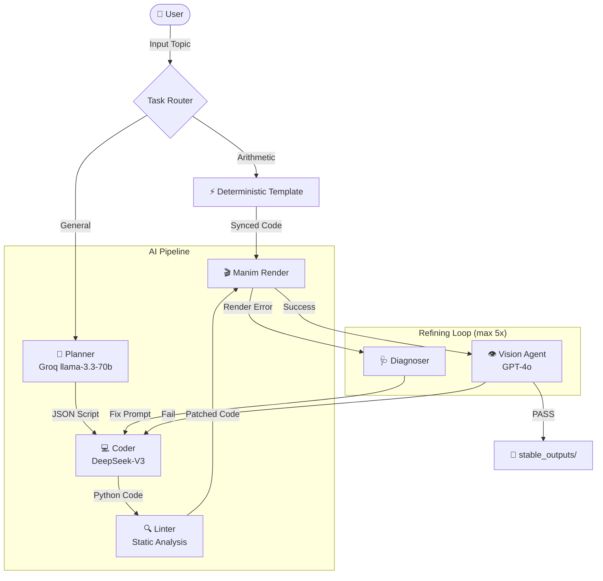

# LLManim Agent 🎬

[](https://www.python.org/)
[](https://www.manim.community/)
[](https://azure.microsoft.com/en-us/services/cognitive-services/speech-services/)
[](LICENSE)

**LLManim Agent** 是一套 AI 驅動的教學數學動畫自動生成系統。輸入任意 K-12 數學主題（如「勾股定理」、「84 + 985 的直式加法」），系統即可全自動產出一支包含精準影音同步旁白的 Manim 教學動畫。

> 本研究成果已提交至 **AIED 2026 LBR (Late Breaking Results)**。

---

## 目錄

- [系統架構](#️-系統架構)
- [效能表現](#-效能表現與測試基準)
- [安裝](#️-安裝)
- [環境變數](#-環境變數)
- [使用指南](#-使用指南)
- [評估系統](#-評估系統)
- [RAG 知識庫](#-rag-知識庫設定)
- [專案結構](#-專案結構)
- [常見問題](#️-常見問題)
- [貢獻指南](#-貢獻指南)

---

## 🏗️ 系統架構

### 路由策略：兩條平行軌道

系統在接收輸入後，會先進行路由判斷：

```text
輸入主題
  │
  ├── 算術任務 (e.g., "84 + 985", "123 × 45")
  │     └── 確定性模板系統 ──────────────────────────────► 產出影片
  │           ├── 100% 正確性保證，不經過 LLM
  │           ├── Azure TTS 語音同步
  │           └── 支援 加/減/乘/除
  │
  └── 通用主題 (e.g., "勾股定理", "圓的面積")
        └── 四階段 Multi-Agent Pipeline ─────────────────► 產出影片
              ├── Phase 1: Planner (JSON 分鏡)
              ├── Phase 2: Coder (Manim 代碼)
              ├── Phase 3: Refining Loop (自動修復，最多 5 次)
              └── Phase 4: Vision QA (GPT-4o 審查)
```

### 四階段 Multi-Agent Pipeline



### 並行處理設計

Planner 輸出分鏡後，三個任務**並行執行**（非序列）：

| 並行任務 | 說明 |
| --- | --- |
| **RAG 檢索** | 從 Weaviate 向量庫撈出高相關的 Manim 黃金範例 |
| **Audio 生成** | Azure TTS 同步合成每個分鏡的旁白語音 |
| **Coder** | 等到 RAG 結果就立刻開始寫 Manim 代碼 |

這套非同步設計每次生成可省下 **15~28 秒**。

### LLM 路由分配

| 角色 | 模型 | 說明 |
| --- | --- | --- |
| Planner | Groq `llama-3.3-70b` | 快速分鏡規劃 |
| Coder | DeepSeek `deepseek-chat` (V3) | 高精度代碼生成 |
| Reviewer | Groq `llama-3.1-8b-instant` | 代碼審查 |
| Vision QA | OpenAI `gpt-4o-mini` | 影像審查 |
| Tier-3 Escalation | DeepSeek `deepseek-reasoner` (R1) | 複雜問題升級 |

---

## 📊 效能表現與測試基準

在 **240 題 K-12（國小至高中）** 數學標竿測試中：

| 指標 | 數值 |
| --- | --- |
| 整體生成成功率 | **90.0%** (216/240) |
| 一次通關率 (1-Iteration, 0 錯誤) | **75.9%** |
| 平均 API 成本 / 支影片 | **$0.0115 USD** |
| 平均生成時間（含渲染與語音） | **~233 秒** |
| 生成影片平均長度 | **~88 秒** |

---

## 🛠️ 安裝

### 系統需求

- **OS**: macOS（推薦）/ Linux
- **Python**: 3.10+
- **依賴工具**:

```bash
brew install ffmpeg librsvg
brew install --cask mactex-no-gui  # LaTeX 環境（Manim 需要）
```

### Clone 與安裝

```bash
git clone https://github.com/childe0905/LLManim_Agent.git
cd LLManim_Agent

python3 -m venv .venv
source .venv/bin/activate

pip install -r requirements.txt
```

---

## 🔑 環境變數

在專案根目錄建立 `.env` 檔案：

```ini
# --- Core LLM ---
GROQ_API_KEY=gsk_xxxxxxxxxxxx          # Planner & Reviewer
DEEPSEEK_API_KEY=sk-xxxxxxxxxxxx       # Coder（必填）

# --- Azure Speech（語音合成）---
AZURE_SPEECH_KEY=xxxxxxxxxxxx
AZURE_SPEECH_REGION=eastus             # 或 southeastasia 等

# --- OpenAI（Vision QA）---
OPENAI_API_KEY=sk-xxxxxxxxxxxx         # GPT-4o 視覺審查

# --- 可選（RAG 影片描述入庫）---
# 僅在執行 rag/ingest_video.py 時需要，平時可省略
```

> **注意**：若未配置 Azure Key，Audio Engine 會自動降級為「估算模式」（根據字數估算時長，不生成真實語音）。

---

## 🚀 使用指南

### 1. 通用教學影片生成（主程式）

輸入任意 K-12 數學主題，自動走完完整 AI Pipeline：

```bash
python main.py
```

啟動後輸入主題，例如：

- `勾股定理的幾何證明`
- `圓柱體體積公式推導`
- `國小分數加法`

輸出影片儲存在 `stable_outputs/`。

### 2. 算術直式計算（確定性模板）

四則運算直式動畫，100% 正確，不走 LLM：

```bash
# 加法
python run_math.py add 84 985

# 減法
python run_math.py sub 1000 273

# 乘法
python run_math.py mul 123 45

# 除法
python run_math.py div 144 12

# 加上 --render 直接渲染影片
python run_math.py add 84 985 --render

# 加上 --interactive 啟用提問暫停模式
python run_math.py add 84 985 --interactive --render
```

### 3. Web 介面（Streamlit）

```bash
streamlit run app.py
```

在瀏覽器開啟顯示的 URL，輸入主題即可生成並即時預覽。

### 4. 手動渲染已生成的代碼

```bash
# 低畫質預覽（快）
manim -pql test_script.py GeneratedScene

# 高畫質輸出
manim -pqh test_script.py GeneratedScene
```

---

## 🧪 評估系統

### 執行 Benchmark 評估

對測試集中的所有題目跑完整 Pipeline 並記錄成功率、成本、時間：

```bash
python run_evaluation.py
```

測試集位於 `evaluation/test_cases_random_240.json`（240 題 K-12 數學）。
評估報告輸出至 `evaluation/reports/`。

### Zero-Shot Baseline 對比

跑無 RAG、無 Reflexion 的純 zero-shot 基準，用於對照實驗：

```bash
python run_zero_shot_baseline.py
```

### 生成測試集

```bash
python generate_240_cases.py
```

---

## 📚 RAG 知識庫設定

### 1. 啟動向量資料庫

本專案使用 Weaviate（需安裝 Docker）：

```bash
docker-compose up -d
```

### 2. 資料入庫

```bash
python rag/ingest_code.py   # 寫入 Manim 代碼範例（必做）
python rag/ingest_video.py  # 寫入影片描述（可選，需 OpenAI Key）
```

詳細說明見 [rag/README.md](rag/README.md)。

---

## 📂 專案結構

```text
LLManim_Agent/
├── main.py                        # 通用生成入口（主程式）
├── run_math.py                    # 算術直式動畫 CLI
├── run_evaluation.py              # Benchmark 評估跑器
├── run_zero_shot_baseline.py      # Zero-shot 對比基準
├── generate_240_cases.py          # 測試集生成工具
├── app.py                         # Streamlit Web UI
│
├── .agent/                        # AI 助理設定檔
│   └── skills/                    # AI 技能庫（包含 Karpathy Guidelines 等）
├── agents/
│   ├── core/
│   │   ├── llm_client.py          # 多 Provider LLM 統一介面
│   │   ├── rag_retriever.py       # Weaviate 向量檢索
│   │   ├── session_logger.py      # 成本與 token 追蹤
│   │   └── manim_api_rules.py     # Manim API 限制規則庫
│   ├── planner/
│   │   └── planner.py             # CoT 分鏡規劃 → JSON
│   ├── coder/
│   │   ├── prompter.py            # Coder prompt 建構
│   │   ├── dspy_coder.py          # DSPy Coder 模組
│   │   ├── code_reviewer.py       # 代碼審查
│   │   ├── manim_diagnoser.py     # 錯誤診斷
│   │   └── lint_manim.py          # 靜態 Lint 分析
│   ├── orchestrator/
│   │   ├── refining_loop.py       # 自動修復主迴圈（最多 5 次）
│   │   ├── task_router.py         # 路由邏輯（算術 vs 通用）
│   │   └── academic_translator.py # 語境轉換
│   └── utils/
│       ├── audio_engine.py        # Azure TTS 語音合成 + 時間同步
│       ├── vision_agent.py        # GPT-4o 視覺 QA
│       └── scene_instrumentor.py  # Scene 狀態監測工具
│
├── templates/                     # 確定性算術模板
│   ├── addition.py
│   ├── subtraction.py
│   ├── multiplication.py
│   ├── division.py
│   ├── common.py
│   └── IMPLEMENTER_GUIDE.md       # 模板開發指南
│
├── evaluation/
│   ├── test_cases.json            # 預設測試集
│   ├── test_cases_random_240.json # 240 題隨機測試集
│   └── reports/                   # 評估報告輸出
│
├── knowledge_base/                # RAG 文件庫
│   ├── CONTRIBUTOR_GUIDE.md
│   └── WORK_ASSIGNMENT.md
│
├── rag/                           # Weaviate 入庫腳本
├── benchmarks/                    # 預渲染基準影片
├── stable_outputs/                # 最終產出影片
├── tests/                         # 單元測試
├── docker-compose.yml             # Weaviate 容器設定
└── requirements.txt
```

---

## 🛠️ 常見問題

### Q: `ffmpeg not found`

```bash
brew install ffmpeg
```

### Q: Manim LaTeX Error

確保已安裝 TeX：

```bash
brew install --cask mactex-no-gui
```

### Q: `ValueError: Called Scene.play with no animations`

Manim 的已知行為，傳入 `play()` 的動畫列表為空時報錯。本專案模板已處理，若自行寫代碼遇到，用 `self.wait()` 替代空的 `play()`。

### Q: Azure TTS 沒有聲音 / 報錯

檢查 `.env` 的 `AZURE_SPEECH_KEY` 和 `AZURE_SPEECH_REGION`。若未設定，系統會自動降級為估算模式（只有動畫、無語音）。

### Q: RAG 檢索無結果

確認 Docker 有在跑（`docker-compose up -d`）且已執行 `python rag/ingest_code.py`。

---

## 🤝 貢獻指南

請遵循 **GitHub Flow**：

1. 從 `main` 開新分支：`git checkout -b feat/your-feature`
2. 修改並 commit
3. Push 到你的分支：`git push origin feat/your-feature`
4. 開 Pull Request → `main`

新增算術模板請先閱讀 [templates/IMPLEMENTER_GUIDE.md](templates/IMPLEMENTER_GUIDE.md)。
知識庫貢獻請先閱讀 [knowledge_base/CONTRIBUTOR_GUIDE.md](knowledge_base/CONTRIBUTOR_GUIDE.md)。
若使用 AI 輔助開發（如 Claude Code），請遵循 [CLAUDE.md](CLAUDE.md) 中定義的 **Karpathy Guidelines**，確保代碼精簡與精準修改。

---

**Lead Developer**: Liao Zhenting
